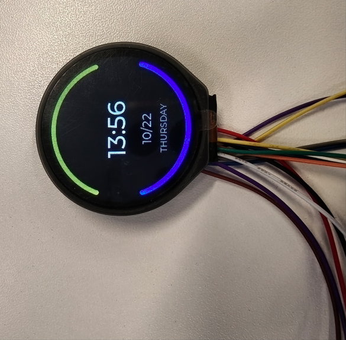
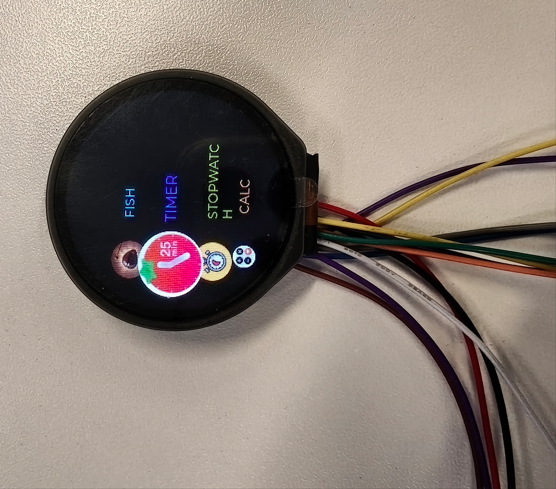
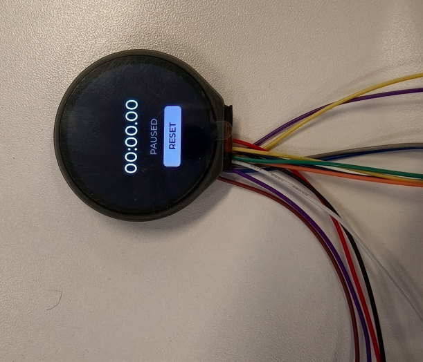
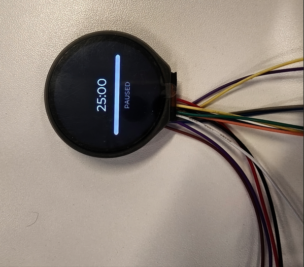
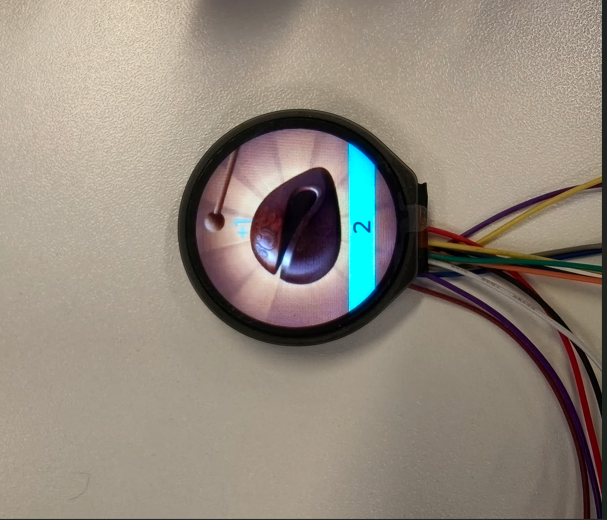
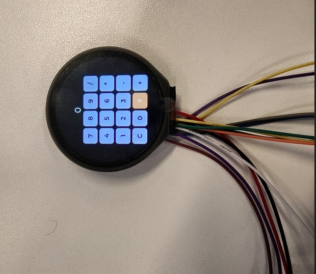
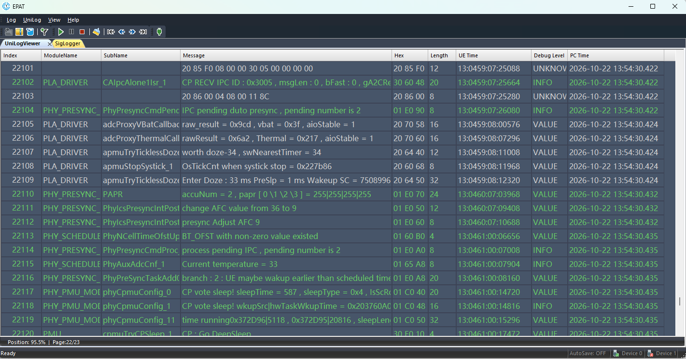

# 圆屏多功能小工具 Demo

[English](./README.md)

圆屏多功能小工具方案是一个基于 UniRTOS 构建的独立运行小屏智能终端方案。

本项目以 UniRTOS 作为核心运行平台，驱动一块 1.28 寸 GC9A01 圆形 SPI 彩屏和 CST816T 电容触摸芯片，结合 LVGL v8.3.11 图形库完成表盘、功能选择页与多个实用小工具页面的渲染与触摸交互。设备不依赖通信、定位等联网能力，聚焦"显示 + 触控交互 + 实用小工具"，开机即自动显示当前日期时间作为默认表盘，支持通过上滑/下滑在表盘与功能选择页之间切换，并可进一步进入秒表、番茄钟、木鱼计数器、计算器等独立功能页面。依托 API 接口丰富的 UniRTOS，方案具备良好的跨模组适配能力，适用于智能手表表盘原型、桌面小挂件、文玩电子配件及圆屏触控交互快速集成等场景。

## 开发资源

| 配件名称        | 数量 | 简要描述                                                       | 获取方法       |
| :-------------- | :--- | :-------------------------------------------------------------- | :------------- |
| QuecDuino开发板 | 1    | 项目运行硬件平台，需搭载模块型号"EG800ZCN_LA"。                 | [点此购买](https://www.quecmall.com/goods-detail/2c90800b9e4a2da8019e71fa2b3000df) |
| GC9A01 圆屏触摸模块 | 1 | 1.28 寸 240x240 圆形 IPS 屏（SPI 接口），集成 CST816T 电容触摸芯片（I2C 接口），支持点击/双击/长按/滑动手势上报。 | 自行准备       |
| USB 数据线      | 1    | 用于连接 PC 和开发板，非"仅充电"类型 USB-A 转 USB-C。            | 自行准备       |
| PC              | 1    | 系统为 Windows 10/Windows 11。                                  | 自行准备       |

## 快速上手

### 硬件连接

圆屏（GC9A01，SPI）与开发板的接线如下（引脚号为模组脚号，非 GPIO 号）：

| 圆屏引脚 | 开发板引脚 | 说明             |
| :------- | :--------- | :--------------- |
| CS       | Pin64      | SPI 片选          |
| MOSI     | Pin63      | SPI 主出从入      |
| MISO     | Pin62      | SPI 主入从出（不使用） |
| SCLK     | Pin49      | SPI 时钟          |
| RST      | Pin22      | 复位（GPIO）      |
| DC       | Pin23      | 命令/数据选择（GPIO） |
| BL       | Pin19      | 背光控制（GPIO）  |

触摸芯片（CST816T，I2C）与开发板的接线如下：

| 触摸芯片引脚 | 开发板引脚 | 说明                  |
| :----------- | :--------- | :--------------------- |
| RST          | Pin66      | 触摸芯片复位（GPIO）    |
| INT          | Pin67      | 手势中断，下降沿触发（GPIO） |
| SCL          | Pin57      | I2C 时钟                |
| SDA          | Pin58      | I2C 数据                |

1. 按上表连接圆屏的 SPI 信号线与触摸芯片的 I2C 信号线、复位脚、中断脚。
2. 使用数据线连接开发板和电脑。

## 软件部署

### 开发环境搭建

参考[UniRTOS快速入门](https://docs.quectel.com/zh/UniRTOS/UniRTOS文档/快速上手/快速上手.html)文档，了解如何搭建开发环境并完成基本开发流程。

### 代码拉取

新开启一个 PowerShell 窗口，执行以下命令：

```Plain
# 拉取示例仓库
unirtos-cli new -r unirtos-maker-examples
# 进入该项目
cd unirtos-maker-examples/small_screen_demo
```

### 构建项目

在开启的 PowerShell 窗口中执行固件编译命令：

```PowerShell
unirtos-cli build -m EG800ZCN_LA -d <项目目录>
```

等待编译结束后，PowerShell 窗口末尾会提示固件编译结果：

```Plain
SUCCESS: Unirtos project built successfully!
```

固件编译成功后通过 QFlash 烧录到开发板中。

### 板上验证

1. 开发板上电后，屏幕自动点亮并显示圆形表盘（时间 + 日期 + 星期）；若 RTC 尚未同步到有效时间，表盘会临时显示 "SYNCING" 占位。



2. 在表盘页向上滑动，进入功能选择页，可看到木鱼计数器、番茄钟、秒表、计算器四个功能图标垂直排列，上下滑动切换当前选中项，选中项图标放大并居中显示。



3. 在功能选择页点击/双击当前选中的图标，进入对应的独立运行页：
   - **秒表**：点击/双击开始或暂停计时，长按屏幕上的 RESET 按钮区域归零计时，下滑返回功能选择页。

     

   - **番茄钟**：默认 25 分钟倒计时，左右滑动调整时长（仅未开始计时时生效），点击/双击开始或暂停，长按复位，倒计时结束后切换为醒目的 "DONE" 完成界面，下滑复位并重新开始。

     

   - **木鱼计数器**：点击屏幕任意位置计数 +1，并伴随放大/高亮动效及漂浮的 "+1" 提示，长按进入清零确认状态，再次点击确认清零，下滑取消确认或返回功能选择页。

     

   - **计算器**：通过屏幕上的 4x4 数字/运算符键盘完成连续四则运算，下滑返回功能选择页（计算状态保留）。

     

4. 在功能选择页的屏幕顶部区域下滑，无论当前选中哪一项都会直接返回表盘页。

### 运行日志

设备正常运行时，通过日志工具可抓取到类似如下的运行日志，可用于确认触摸手势识别、页面切换等状态是否正常：



## 效果说明

项目在各页面下的交互效果如下：

- **表盘页**：常驻显示时间/日期/星期，上滑进入功能选择页。
- **功能选择页**：图标按选中状态垂直排列，选中项放大居中并置于最上层显示，相邻项依次缩小、向圆屏边缘内侧收拢，名称字体随行距自动缩放。
- **秒表/番茄钟/木鱼计数器/计算器运行页**：均支持下滑快速返回功能选择页，各页面保留各自运行状态（计时/计数/计算结果），再次进入时无需重新开始。

## 常见问题

- **屏幕不显示任何内容**：检查 SPI 接线（尤其 CS/MOSI/SCLK/RST/DC/BL）是否按上表连接，确认开发板型号为 EG800ZCN_LA。
- **触摸无响应**：检查 I2C 接线（SCL/SDA）与 INT/RST 引脚连接，确认触摸芯片型号为 CST816T（芯片 ID 寄存器应读到 `0xB5`）。
- **表盘长时间显示 "SYNCING"**：表示 RTC 尚未同步到有效时间，需等待模组注册网络完成时间同步，或检查 SIM 卡与网络状态。
